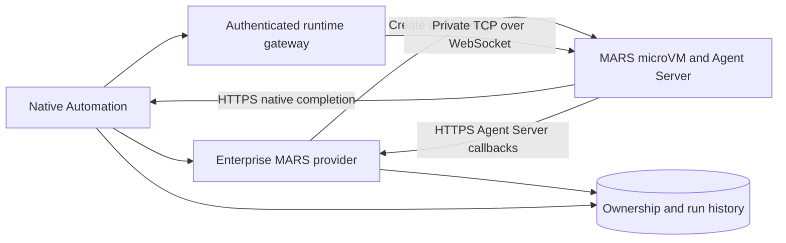

# OpenHands Enterprise on DigitalOcean MARS

Run interactive OpenHands conversations and native Automation jobs in DigitalOcean MARS microVMs while keeping the Enterprise control plane on your own Docker Compose host. A standard native automation run gets one MARS VM; independent runs provide concurrency.

This repository supplies the MARS sandbox provider, authenticated runtime gateway, version-checked image patches and installation tools. **You use the official OpenHands Compose stack with this add-on. You do not need a copy of the original evaluation machine or its AWS configuration.** The host can be your own Linux machine on DigitalOcean, AWS or another provider.

The evaluated integration passed **1, 5 and 10 concurrent native jobs**, including persisted completion outcomes and automatic VM cleanup. See [results and screenshots](docs/VALIDATION.md). This is a version-pinned customer evaluation package; a real Gemini conversation and a post-reload follow-up also passed on one MARS VM. Broader LLM workloads, fresh customer onboarding and Kubernetes capacity remain qualification work.

## What the integration does

- Enterprise creates, identifies, pauses, resumes and deletes MARS sandboxes through its existing Sandbox V1 interfaces.
- The runtime gateway carries HTTP and WebSocket traffic to Agent Server inside the VM through DO's authenticated port-forward. The VM has no public inbound service URL.
- The VM calls back to Enterprise over HTTPS. Automation keeps run status and completion outcomes in its database, so the native history survives VM cleanup.
- Docker Compose hosts the control plane. MARS provides the job's CPU, memory and workspace. An existing LLM gateway/provider remains a separate part of your model configuration. Allow its resolved hostname through MARS egress using `MARS_LLM_EGRESS_HOSTS`; see the installation guide.



[Architecture and five integration seams](docs/INTEGRATION_SEAMS.md) explains how this follows the earlier E2B provider pattern and where MARS requires different behavior.

## Before you install

Use a Linux evaluation host with Python **3.11+**, Docker Engine and Docker Compose **2.24.4+**. The tested control-plane host had four vCPUs and 16 GB RAM; this is an observed configuration, not a minimum sizing guarantee.

You also need:

| Prerequisite | What to prepare |
|---|---|
| OpenHands version | Enterprise **1.88.0**, Automation **1.30.0**, Canvas **1.35.0**. The installer fetches the checksum-verified official Compose file for this release. It refuses unsupported patched bases. |
| Enterprise access | Registry access and the Enterprise licence/evaluation entitlement appropriate to your installation. You build the patched images from official released images. |
| MARS access | Your own DO team token and an operator-created environment config using the builtin `openhands` harness. The account used for validation did not support the custom-image path. |
| Public HTTPS | Separate application and runtime hostnames, with DNS/TLS configured by your operator. MARS must reach the callback hostname over egress; scripts calling their own public runtime also need that exact hostname allowed. |
| Baseline | Verify the official stock installation is healthy and can start its first normal conversation before switching to MARS. Take database backups before changing an existing deployment. |

Install Docker using the [official Docker Engine instructions](https://docs.docker.com/engine/install/). The add-on does not install system packages, configure your firewall/DNS, create a DO account or create application users for you.

## Install the add-on

Download the versioned ZIP and checksum from [GitHub Releases](https://github.com/rajistics-demo/openhands-mars-compose/releases), or clone this repository and check out the corresponding release tag. Extract the bundle on the machine that will run Compose.

For this release, download both assets from [v1.88.0-mars2](https://github.com/rajistics-demo/openhands-mars-compose/releases/tag/v1.88.0-mars2), then run:

```bash
sha256sum -c openhands-enterprise-mars-1.88.0-mars2.zip.sha256
unzip openhands-enterprise-mars-1.88.0-mars2.zip
cd openhands-enterprise-mars-1.88.0-mars2
python3 installer/mars_setup.py --help
```

The setup tool prepares a separate installation directory containing the official Compose file and your private configuration. Keep that directory outside this source checkout. Supply your own credentials there; none are included in the release.

Follow the [step-by-step installation guide](docs/INSTALL.md) for the exact preparation, baseline, configuration, build and activation commands. The setup stages are explicit: preparing files or running checks does not activate the MARS backend.

### Customer configuration

| Setting | Purpose |
|---|---|
| Application HTTPS origin | Enterprise UI/API and native completion callback target. |
| Runtime HTTPS origin | Session-authenticated gateway for Agent Server HTTP/WebSocket traffic. |
| `DO_MARS_CONFIG_ID` | The environment config you registered in your DO team. |
| DO token file | Provider control/port-forward credential, read only on the control plane. |
| Bootstrap init-key file | Must match `OH_SECRET_KEY` in your MARS environment config. |
| Session signing-key file | Signs per-VM JWTs; keep stable across app, worker and gateway. |
| Sandbox admission cap | The staged installer keeps this evaluation at ten per identity. The manual overlay exposes `MARS_MAX_SANDBOXES` for separately qualified configurations. Exceeding the cap can pause the oldest running sandbox; it is not a queue or autoscaler. |

The [environment template](templates/environment.example.yaml) describes the evaluated MARS configuration. Create a new environment config for each release rather than modifying an existing one. Store rendered manifests, secret files and site settings outside git. See the install guide for Linux file ownership/read permissions.

## Start an interactive conversation

After activating the MARS add-on, open Enterprise Canvas, choose **New Chat**, select a configured model and send your prompt. The active sandbox provider is MARS, so the agent's terminal, files and tools run inside a MARS VM while Compose hosts the Enterprise control plane. No separate MARS launch command is needed.

Enterprise creates a new MARS VM when the conversation needs a sandbox and no eligible running sandbox can be reused. Its normal sandbox-grouping settings can place multiple conversations in an existing VM; **New Chat does not guarantee a new VM every time**. Continuing an existing chat uses its assigned sandbox, subject to lifecycle availability. Native automation runs get their own assigned VMs.

The model connection must be funded and usable, and the resolved LLM endpoint must be allowed in the MARS environment config through `MARS_LLM_EGRESS_HOSTS`. A small coding task is a useful first check: ask the agent to write and execute a Python script in `/workspace` and report the observed output. Confirm terminal execution, rather than only a text response. See the [real Gemini conversation and post-reload follow-up results](docs/LLM_VALIDATION.md).

## Validate your installation

After onboarding, use an org-bound API key for your intended evaluation user and organization. The validator verifies its principal and actual organization binding before writing anything.

```bash
export OPENHANDS_HOST=https://app.example.invalid
export OPENHANDS_ORG_ID='<evaluation-org-id>'
export OPENHANDS_EXPECTED_EMAIL='<evaluation-user-email>'
# Set OPENHANDS_API_KEY securely in your shell, outside command history.
python3 validation/run_native_validation.py --runs 1
# After the single run passes, and within your DO quota:
python3 validation/run_native_validation.py --runs 10
```

The validator creates an **inactive** definition and manually dispatches normal native runs. Each job computes a known result, touches 64 MiB of memory, writes a workspace proof, holds for 120 seconds and sends a completion callback. It checks `COMPLETED` status and persisted passing `task_outcome`, and retains native run history. Save validator output outside git because it contains private run identifiers. Confirm resource cleanup in your DO account as well.

These tests do not invoke an LLM. Configure and validate your preferred model separately. To reproduce the stronger simultaneous-process/provider proof or understand the load measurements, read [Live validation](docs/VALIDATION.md).

## How we applied DigitalOcean's guidance

| Guidance | Current behavior |
|---|---|
| Immutable template per release; image digest pinning | Control-plane images are pinned. MARS uses an operator-selected config. Runtime digest pinning was rejected on the evaluated account's custom-image path, so it is not claimed. |
| Short-lived per-VM secrets and egress callbacks | Session-bound expiring JWTs, expiring native run keys and public HTTPS callbacks are implemented. The config-level bootstrap secret is shared, and native run keys remain owner-scoped rather than callback-only. |
| Private HTTP/WebSocket service connectivity | Implemented through authenticated DO port-forward, one WebSocket per TCP connection. Only Agent Server port 8000 is exposed through the gateway. |
| Pause/resume, persistence and reconnect | Plain pause/resume was exercised. Run state/outcomes remain in the control plane. Checkpoint integration, general process restoration, seamless key rotation and in-flight pause fencing remain open. |

The [technical integration contract](docs/INTEGRATION_CONTRACT.md) maps each recommendation to code behavior, evidence and remaining assumptions. It distinguishes implemented behavior from observations and planned work.

## Documentation and review

See the [provider status record](provider.json) for release and pilot validation.

- [Install and configure](docs/INSTALL.md)
- [Architecture and five integration seams](docs/INTEGRATION_SEAMS.md)
- [Technical contract and DO guidance](docs/INTEGRATION_CONTRACT.md)
- [Test results, screenshots and scale measurements](docs/VALIDATION.md)
- [Version compatibility and runtime image selection](docs/VERSIONS.md)
- [Security review and remaining qualification work](docs/SECURITY_REVIEW.md)
- [Rollback and backup compatibility](docs/ROLLBACK.md)
- [Developer tests](docs/DEVELOPMENT.md)

The patches modify licensed OpenHands Enterprise files and grant no additional product rights. Use an Enterprise image you are licensed to use; the new Enterprise modules follow the same product terms. Automation is MIT. The release contains placeholders and sanitized evidence, with no operator credentials or site-specific infrastructure.
