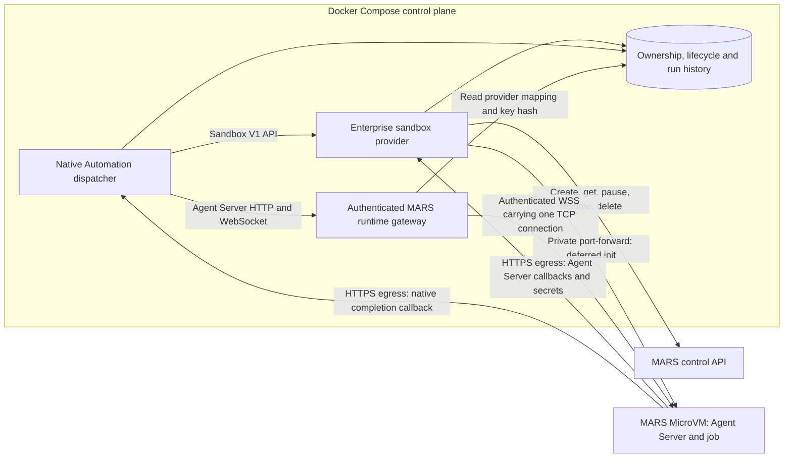

# Integration seams: E2B pattern → DigitalOcean MARS

The E2B backend (PR458) and the shared managed sandbox store (PR466) set the pattern this provider follows. Both were written by Joe Laverty. MARS plugs into the same `ManagedSandboxService` / injector seams, and Canvas, Automation and `/api/v1` see no new API. The "status" column below separates what this package implements from what was observed live (coordinator receipts) and what is still open.

The DO team token stays on the control plane. The guest receives a session-bound JWT and the native run's expiring owner key. Run status and persisted outcomes remain in the control plane; guest-only files and logs need explicit export before deletion. See the [technical contract](INTEGRATION_CONTRACT.md). The diagram shows logical responsibilities, with no site-specific infrastructure.

| # | Seam | E2B pattern | MARS mapping in this package | Status |
|---|---|---|---|---|
| 1 | **Specs, templates and image selection** | `E2BSandboxSpecService` maps a spec to an E2B template id. | `DoMarsSpecServiceInjector` exposes operator-owned `DoMarsSpecInfo` entries, each bound to one MARS environment config (`DO_MARS_CONFIG_ID`) plus the deferred-init key. Enterprise never creates or edits configs. | Implemented and live-tested with the **builtin `openhands` harness (Agent Server 1.58.2)**. Custom harness or digest pinning is rejected on Private Beta (`AGENT_KIND_CUSTOM`). DO guidance: register a **new immutable template/config per release** and pin a digest. That is not yet possible on this account (VERSIONS.md). |
| 2 | **Provider resource lifecycle, durable ownership, recovery and store** | Create, get, pause, resume and kill on the provider id, with ownership on the `v1_remote_sandbox` row. | `DoMarsSandboxService` uses the DO `/v2/agents/sessions` create, get, list-by-name, pause, resume and delete calls. The durable create intent (`provider_create_intent_at`) is committed **before** the provider call. `provider_resource_id` is committed before init, with a unique `(backend, provider_resource_id)` index. An ambiguous create (timeout, 5xx, 409) is **never repeated**: it is adopted only on one exact match, otherwise kept fail-closed for the operator. Pause, idle and delete are owned by Enterprise lifecycle (`OH_SANDBOX_LIFECYCLE_*`), and the operator config should keep DO from auto-pausing on its own. | Implemented. Unit-tested on real PostgreSQL. Live create, pause, resume and delete were observed by the coordinator. |
| 3 | **Deferred initialization, per-VM authentication, secrets and callbacks** | The E2B sandbox receives env and session keys at create time. | The guest boots **dormant**. Enterprise calls `POST /api/init` over the private tunnel with `X-Init-API-Key`, then sends a per-session key: a short-lived JWT bound to the Enterprise sandbox id, DO session UUID, issuer, audience and expiry (default 8 h, max 24 h). Its hash and encrypted value are stored. Callbacks go to `DO_MARS_CALLBACK_URL/api/v1/webhooks`, and secrets are read through the stock sandbox-scoped endpoints. The DO token stays server-side. | Implemented. Limitations: the bootstrap init key is shared across VMs (C1). An expired key needs a fresh VM (C6). Egress is the exact callback hostname **plus platform defaults**, so it is not literally one host (C3). |
| 4 | **Private HTTP/WebSocket transport** | E2B gives each port a public host. | `mars-gateway` (`do_mars_proxy.py`) authenticates the caller from the DB hash **before** any dial. It requires the settled `lifecycle_state == running` (a port-forward can wake a paused VM), using a plain read with no row lock so the lifecycle worker's idle probe through the gateway cannot conflict with its own row lock. This is not atomic with a concurrent pause (SECURITY_REVIEW C4). It then opens **one** authenticated DO port-forward WebSocket per loopback TCP connection to Agent Server port 8000. It supports full HTTP chunking and streaming and inner WebSockets (aiohttp). The MARS-only native startup probe authenticates `/alive` with the existing session key; the shared provider implementation is unchanged. Cookies, `Authorization` and init headers are stripped, and an encoded `api/init` is denied. SDK first-frame auth is limited to 5 s and 8 KiB. There is no blind POST replay. Agent Server ingress has its own origin and remains on port 8000. Optional Canvas previews route each sandbox through a separate origin to port 8011. The Canvas app exchanges its sandbox key for a ten-minute preview cookie restricted to that host. The gateway validates the cookie and running state before a private DO tunnel and strips the cookie before forwarding. | Implemented and unit-tested. Live HTTP, WS and callbacks were observed. Checkpoints are not implemented: DO checkpoints whole-machine state (files and live memory), and all TCP/WS connections must reconnect after a resume. Only a plain pause was observed (workspace and synthetic RAM survived), which is not a checkpoint guarantee. |
| 5 | **Standard native Automation run, outcome and history** | Automation dispatches a run to a sandbox and gets a completion callback. | One native run means one MARS VM, created by the stock dispatcher. Automation patches cover three things. First, a guest-facing API URL (`AUTOMATION_SANDBOX_OPENHANDS_API_URL`) separate from the private service URL. Second, opt-in expiring per-run keys (`AUTOMATION_RUN_KEY_TTL_SECONDS`, owner-scoped and not limited to the callback). Third, `task_outcome` persisted into `run_metadata` (readable through the runs API; Canvas 1.35.0 does not render it, see STATUS.md). State and history stay in Enterprise and Automation. `validation/` runs one deterministic, no-LLM job. | Implemented and tested (Automation suite). Live 1/5/10 independent-run checks passed; see VALIDATION.md. **No fan-out**: there is no coordinator, child-run or ten-child feature. One real Gemini conversation and a post-reload follow-up passed separately; concurrent LLM capacity is unqualified. |
| 6 | **Opt-in warm pool: pre-created hot/paused inventory, claimed at create time** | Not present in the E2B pattern. | `do_mars_pool_store.py` adds one new table (`do_mars_pool_slot`, migration `do_mars_002`), independent of `v1_remote_sandbox` and read by no non-pool code path (see that migration's docstring for why it is a separate table, not a subtype). `DoMarsPoolConfig` (`DO_MARS_POOL_*` env, disabled by default) sets `min_hot`/`min_paused_reserve`/`max_total` for exactly one `(backend, sandbox_spec_id, config_id)`. A reconciler process (`do_mars_pool_worker.py`, run as its own opt-in Compose service/profile - never inside the per-request sandbox-service injector) ticks under a Postgres advisory lock: recovers crashed/stuck claims, reaps unhealthy or stale slots, health-checks HOT_READY slots by dialing the same dormant-init probe used at boot (never a paused slot - that would risk waking it; paused inventory is confirmed via `is_still_paused`, a control-plane status read only), then replenishes/rebalances one step per tick toward the configured targets, promoting idle `PAUSED_RESERVE` ahead of a brand-new create whenever that would not change total inventory. Claiming a slot is two steps, each itself one atomic transaction: `claim_one` (`SELECT ... FOR UPDATE SKIP LOCKED`) takes exactly one eligible, recently-health-checked slot to `CLAIMING`, so concurrent claimers can never select the same row; `promote_claim_to_sandbox` then re-locks that same CLAIMING row and, in one further transaction, inserts the new owned `v1_remote_sandbox` row and deletes the pool slot row together - so a slot is deleted from pool inventory if and only if an owned sandbox row for it was durably created, and it is never reassigned to a different owner once claimed. This seam is additive only: `DoMarsSandboxService`'s existing create/pause/delete paths, defaults and non-pool behavior are unchanged, and a disabled pool (the default) leaves an empty, unused table. | **Store and reconciler implemented and unit-tested** against real PostgreSQL (concurrency/atomicity, reconciler state machine including a deliberately induced crash-window race - see test_do_mars_pool_store.py, test_do_mars_pool_reconciler.py; `claim_one` now takes an additive `states` parameter, defaulting to its original HOT_READY+PAUSED_RESERVE set so no existing caller's behavior changed, exercised by `test_claim_states_defaults_to_hot_and_paused_preferring_hot`/`test_claim_states_hot_only_skips_a_paused_reserve_slot`). **`DoMarsSandboxService.start_sandbox` now calls `claim_one`/`promote_claim_to_sandbox`** (new `_start_sandbox_from_pool` method): at the top of `start_sandbox`, after spec resolution and `pause_old_sandboxes`, if `self.pool_config.enabled and self.pool_config.sandbox_spec_id == spec.id`, it calls `claim_one(..., states=(PoolSlotState.HOT_READY,))`; on a hit, it builds the `StoredSandbox` row with `provider_resource_id` already set to the slot's and `provider_create_intent_at=None`, passes it to `promote_claim_to_sandbox`, then runs the existing `wait_ready`/`_init_agent_server`/`as_info` tail (reusing the exact same shielded-delete `except BaseException` cleanup `start_sandbox`'s own create path uses, not a second implementation of it); on a miss (`None`), it falls through to today's unmodified create path, generating its own fresh `sid`/key with no trace of the aborted claim attempt left anywhere (`claim_one` only commits on a hit). The real session key is issued by `issue_session_key(row.id, slot.provider_resource_id)` scoped to the newly-minted sandbox id, not reused from however the slot was pre-created, so a claimed VM is never initialized with tenant secrets before this point. Restricting the service's own claim to HOT_READY only (never resuming a PAUSED_RESERVE slot inline) remains the deliberate scope cut from the previous round: the reconciler already promotes paused inventory to hot ahead of configured demand in the background, keeping "resume and wait" logic in exactly one place. **Caveat, stated precisely rather than silently assumed away**: this call site could not be executed in this standalone validation environment - `openhands.agent_server.utils.utc_now`, the real ORM-mapped `sandbox_store.StoredSandbox`, and the `ManagedSandboxService` base class (`_new_stored_sandbox`, `resolve_sandbox_spec`, `require_user_id`, `wait_ready`, `as_info`) are all outside this repository and were not reconstructed as fakes, because doing so would mean guessing their unseen behavior rather than testing against it (the same gap that already leaves `test_do_mars.py` uncollectable here - see STATUS.md/evidence). What *was* verified here instead: `ruff check --select F,E9` (no undefined names/unused imports/syntax errors) and `python -m py_compile` over the edited file, plus a manual, line-by-line keyword-argument match of both new call sites against `claim_one`'s and `promote_claim_to_sandbox`'s real, fully-visible signatures and documented contracts (including that `create_sandbox_row` must not commit - the new `_create_row` closure only calls `db_session.add`). This is a static/contract-level check, not an executed integration test; treat the new `start_sandbox` branch and `_start_sandbox_from_pool` as unexecuted until run against the real Enterprise tree. **Not live-tested against DigitalOcean** for the same reason: `DoMarsPoolProviderAdapter` (the thin wrapper over the same `DoMarsClient` calls `DoMarsSandboxService` already makes) has not been exercised against a real MARS session. 50-sandbox-concurrency pool benchmarking was explicitly out of scope for this round (deprioritized by the requester) and was not attempted. **Review fix**: the claim query and the worker's own slot-creation call were previously keyed on a separately-settable `DO_MARS_POOL_CONFIG_ID` (defaulting to the literal string "default"), independent of the provider's real config id for the spec. That could silently diverge from `spec.config_id`/`DO_MARS_CONFIG_ID` after an operator rotated the real config, letting a stale-config pool VM be claimed for a request now resolving to a different one. Fixed by removing that separate knob entirely: `_start_sandbox_from_pool` now claims with `config_id=spec.config_id` (the exact value `start_sandbox`'s own create path already passes to `do.create_session`), and `do_mars_pool_worker.py` reads `DO_MARS_CONFIG_ID` directly (failing fast, before any Enterprise-core import, if it is unset) instead of a pool-only env var - see `test_missing_do_mars_config_id_exits_before_importing_enterprise_core` and `test_pool_config_id_env_var_no_longer_read` in test_do_mars_pool_worker.py (executed here) and `test_pool_claim_is_scoped_to_the_resolved_spec_config_id` in test_do_mars_package_fixes.py (same unexecuted-here caveat as the rest of that file). Compose/mars.env.example no longer expose `DO_MARS_POOL_CONFIG_ID`; the reconciler's `DB_HOST`/`DB_PORT` were also made overridable (previously hardcoded to the bundled `db` service) for bring-your-own managed PostgreSQL, documented in mars.env.example next to the existing session-pinning requirement. |

## Planning reconciled with the recovered final source

The planning documents were reconciled with the recovered final source. This package follows the source, not the plan, wherever they differ.

- The planning reviewed Enterprise 1.92.0. The deployed baseline, and this package's baseline, is **1.88.0**.
- The plan proposed a generic `RuntimeTransport` and multi-provider gateway. It is still deferred, and the gateway is MARS-only.
- The planned migration `215` (down `214`, from AWS) was replaced by `do_mars_001` (down `213`).
- Custom fan-out and child-run code existed in earlier iterations. It is **withdrawn and not shipped**.
- The unpublished AWS Lambda pool imports and injectors in the deployed `config.py`, `docker_utils.py` and `sandbox_store.py` are not shipped.
