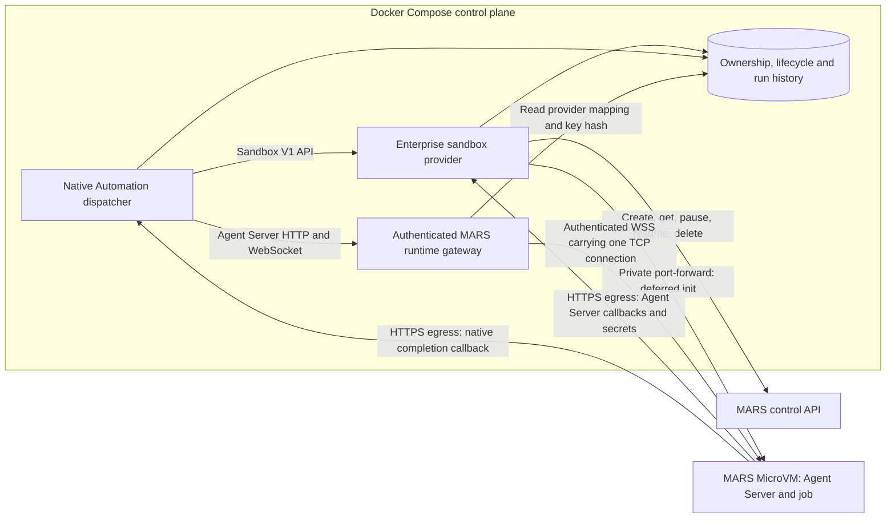

# Integration seams: E2B pattern → DigitalOcean MARS

The E2B backend (PR458) and the shared managed sandbox store (PR466) set the pattern this provider follows. Both were written by Joe Laverty. MARS plugs into the same `ManagedSandboxService` / injector seams, and Canvas, Automation and `/api/v1` see no new API. The "status" column below separates what this package implements from what was observed live (coordinator receipts) and what is still open.

The DO team token stays on the control plane. The guest receives a session-bound JWT and the native run's expiring owner key. Run status and persisted outcomes remain in the control plane; guest-only files and logs need explicit export before deletion. See the [technical contract](INTEGRATION_CONTRACT.md). The diagram shows logical responsibilities, with no site-specific infrastructure.

| # | Seam | E2B pattern | MARS mapping in this package | Status |
|---|---|---|---|---|
| 1 | **Specs, templates and image selection** | `E2BSandboxSpecService` maps a spec to an E2B template id. | `DoMarsSpecServiceInjector` exposes operator-owned `DoMarsSpecInfo` entries, each bound to one MARS environment config (`DO_MARS_CONFIG_ID`) plus the deferred-init key. Enterprise never creates or edits configs. | Implemented and live-tested with the **builtin `openhands` harness (Agent Server 1.58.2)**. Custom harness or digest pinning is rejected on Private Beta (`AGENT_KIND_CUSTOM`). DO guidance: register a **new immutable template/config per release** and pin a digest. That is not yet possible on this account (VERSIONS.md). |
| 2 | **Provider resource lifecycle, durable ownership, recovery and store** | Create, get, pause, resume and kill on the provider id, with ownership on the `v1_remote_sandbox` row. | `DoMarsSandboxService` uses the DO `/v2/agents/sessions` create, get, list-by-name, pause, resume and delete calls. The durable create intent (`provider_create_intent_at`) is committed **before** the provider call. `provider_resource_id` is committed before init, with a unique `(backend, provider_resource_id)` index. An ambiguous create (timeout, 5xx, 409) is **never repeated**: it is adopted only on one exact match, otherwise kept fail-closed for the operator. Pause, idle and delete are owned by Enterprise lifecycle (`OH_SANDBOX_LIFECYCLE_*`), and the operator config should keep DO from auto-pausing on its own. | Implemented. Unit-tested on real PostgreSQL. Live create, pause, resume and delete were observed by the coordinator. |
| 3 | **Deferred initialization, per-VM authentication, secrets and callbacks** | The E2B sandbox receives env and session keys at create time. | The guest boots **dormant**. Enterprise calls `POST /api/init` over the private tunnel with `X-Init-API-Key`, then sends a per-session key: a short-lived JWT bound to the Enterprise sandbox id, DO session UUID, issuer, audience and expiry (default 8 h, max 24 h). Its hash and encrypted value are stored. Callbacks go to `DO_MARS_CALLBACK_URL/api/v1/webhooks`, and secrets are read through the stock sandbox-scoped endpoints. The DO token stays server-side. | Implemented. Limitations: the bootstrap init key is shared across VMs (C1). An expired key needs a fresh VM (C6). Egress is the exact callback hostname **plus platform defaults**, so it is not literally one host (C3). |
| 4 | **Private HTTP/WebSocket transport** | E2B gives each port a public host. | `mars-gateway` (`do_mars_proxy.py`) authenticates the caller from the DB hash **before** any dial. It requires the settled `lifecycle_state == running` (a port-forward can wake a paused VM), using a plain read with no row lock so the lifecycle worker's idle probe through the gateway cannot conflict with its own row lock. This is not atomic with a concurrent pause (SECURITY_REVIEW C4). It then opens **one** authenticated DO port-forward WebSocket per loopback TCP connection to Agent Server port 8000. It supports full HTTP chunking and streaming and inner WebSockets (aiohttp). The MARS-only native startup probe authenticates `/alive` with the existing session key; the shared provider implementation is unchanged. Cookies, `Authorization` and init headers are stripped, and an encoded `api/init` is denied. SDK first-frame auth is limited to 5 s and 8 KiB. There is no blind POST replay. Previews and other ports are disabled. | Implemented and unit-tested. Live HTTP, WS and callbacks were observed. Checkpoints are not implemented: DO checkpoints whole-machine state (files and live memory), and all TCP/WS connections must reconnect after a resume. Only a plain pause was observed (workspace and synthetic RAM survived), which is not a checkpoint guarantee. |
| 5 | **Standard native Automation run, outcome and history** | Automation dispatches a run to a sandbox and gets a completion callback. | One native run means one MARS VM, created by the stock dispatcher. Automation patches cover three things. First, a guest-facing API URL (`AUTOMATION_SANDBOX_OPENHANDS_API_URL`) separate from the private service URL. Second, opt-in expiring per-run keys (`AUTOMATION_RUN_KEY_TTL_SECONDS`, owner-scoped and not limited to the callback). Third, `task_outcome` persisted into `run_metadata` (readable through the runs API; Canvas 1.35.0 does not render it, see STATUS.md). State and history stay in Enterprise and Automation. `validation/` runs one deterministic, no-LLM job. | Implemented and tested (Automation suite). Live 1/5/10 independent-run checks passed; see VALIDATION.md. **No fan-out**: there is no coordinator, child-run or ten-child feature. One real Gemini conversation and a post-reload follow-up passed separately; concurrent LLM capacity is unqualified. |

## Planning reconciled with the recovered final source

The planning documents were reconciled with the recovered final source. This package follows the source, not the plan, wherever they differ.

- The planning reviewed Enterprise 1.92.0. The deployed baseline, and this package's baseline, is **1.88.0**.
- The plan proposed a generic `RuntimeTransport` and multi-provider gateway. It is still deferred, and the gateway is MARS-only.
- The planned migration `215` (down `214`, from AWS) was replaced by `do_mars_001` (down `213`).
- Custom fan-out and child-run code existed in earlier iterations. It is **withdrawn and not shipped**.
- The unpublished AWS Lambda pool imports and injectors in the deployed `config.py`, `docker_utils.py` and `sandbox_store.py` are not shipped.
