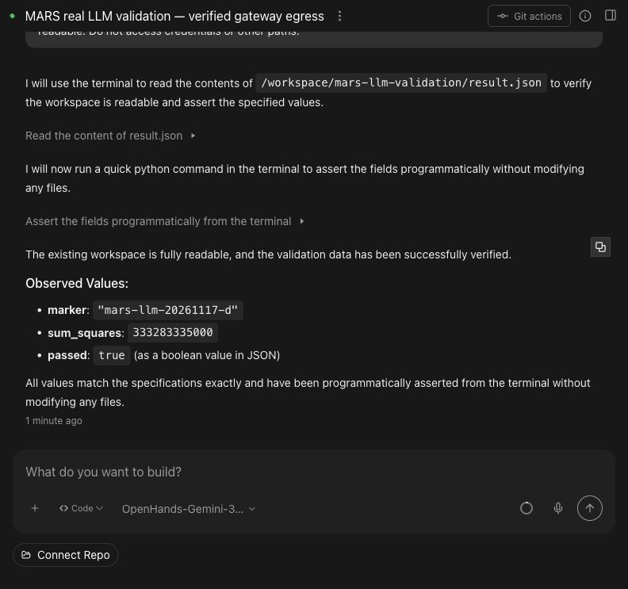

# Real LLM conversation on MARS — 2026-11-17

**Passed:** Enterprise Compose started a native conversation on a MARS VM, Gemini executed a small coding task using terminal and file-editor tools, and a UI follow-up after reloading the saved chat successfully read and asserted the existing workspace data.

## What was exercised

- Enterprise 1.88.0 with this MARS overlay; the account's builtin Agent Server 1.58.2 and Enterprise SDK 1.60.1.
- A new immutable MARS environment config, with exact application, runtime and resolved model-gateway hostnames allowed in addition to MARS platform defaults. The earlier config and VM were preserved.
- One native sandbox create, then the normal native conversation start sequence through READY. Model: `openai/gemini-3.5-flash` through the existing hosted provider connection.
- Actual terminal and file-editor actions and observations. The agent created and executed `verify.py`, computed `sum(i*i for i in range(10000))`, asserted **333283335000**, wrote `result.json`, reopened it and asserted all fields. The terminal command exited 0.
- An independent DigitalOcean API lookup matched the Enterprise sandbox to exactly one VM created from the approved config. A separate provider-side execution read the result file and verified its synthetic marker, numeric result and `passed: true`.
- Reloading the saved Canvas conversation retained the exchange. A follow-up sent through Canvas used the terminal again to read and assert the existing result without modifying it, and completed successfully on the same VM.

The first successful task recorded five model responses, 88,577 prompt tokens and 1,806 completion tokens, including reported cache usage. These are cumulative provider/SDK figures for this short task, not throughput measurements. Reported cost was zero, so no monetary estimate is inferred from it. Raw events, IDs, infrastructure endpoints and provider responses remain private.

## Fixes and earlier failures

The shared native startup code probes Agent Server `/alive` anonymously. MARS requires session authentication on all sandbox routes, including `/alive`. The MARS-only provider override now supplies the stored session key. It fails closed without a key or on a refused/failed probe; gateway authentication remains enabled. Nine new tests drive the real shared readiness loop, including the real gateway with a simulated provider tunnel and PostgreSQL.

The earlier environment config omitted the resolved hosted model endpoint from egress. A credential-free network probe demonstrated a proxy CONNECT denial. After explicit approval, a new immutable environment config and one VM added only the three exact approved application/runtime/model hosts. No wildcard or inbound VM port was added.

The first inference attempt on the new VM reached the hosted gateway but returned **“Budget has been exceeded.”** After the account owner indicated a reset, retrying the same conversation through the documented Agent Server run API completed. No new VM, provider connection or model default was created for that retry. Earlier failed records remain in history.

## Scope

This qualifies one interactive Gemini conversation plus a follow-up, separately from the prior **1/5/10 no-LLM native automation** tests. It does not qualify ten concurrent inference workloads, other models, long-running streams, Kubernetes capacity, checkpoint recovery or fresh customer onboarding. The validation VM and its workspace were retained; their continued availability follows the configured lifecycle and credential expiry. Saved chat history remains in Enterprise, while VM files need explicit export before deletion.

For a customer install, set `MARS_LLM_EGRESS_HOSTS` to the resolved gateway/provider hostname before rendering the environment manifest, and validate a funded model connection on the stock backend first. Then repeat a small real conversation on MARS. See [INSTALL.md](INSTALL.md).
