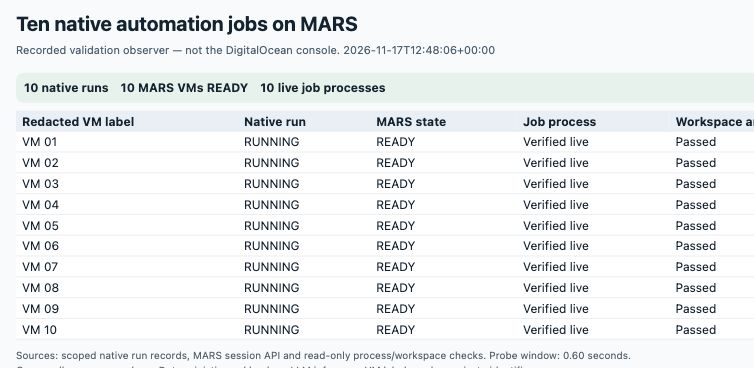
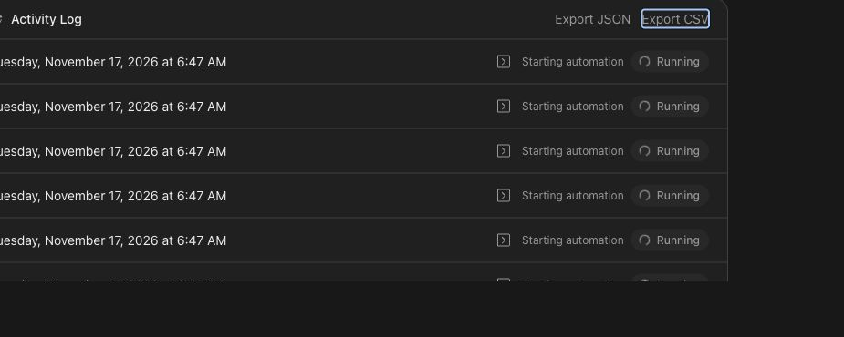
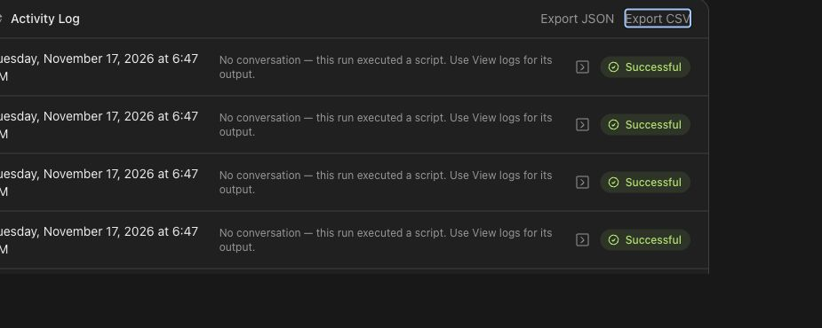

# Live validation — 17 November 2026

**Passed:** ten independent standard native Automation runs concurrently executed jobs on ten distinct DigitalOcean MARS VMs. Every run ended `COMPLETED`, every persisted `run_metadata.task_outcome.passed` was true, and all ten provider sessions were confirmed `DESTROYED` after automatic cleanup. One native run owned one sandbox. No parent, child or fan-out feature was used.

## What ran

The existing AWS Compose evaluation ran Enterprise 1.88.0, Automation 1.30.0 and Canvas 1.35.0 with the MARS changes. App, worker and runtime gateway used the same reviewed MARS module revision. The test definition stayed **DRAFT/inactive** and the Canvas **Test** action used the native dispatcher; no schedule was enabled. The durable native activity log and database records remain on the evaluation installation.

Each script computed a known sum, touched 64 MiB of memory, wrote a unique workspace proof, held for 120 seconds, checked file and memory contents, and sent the normal completion callback. These runs also performed a read-only Enterprise lookup and a request through their own authenticated runtime gateway. No model inference ran.

| Cohort | Concurrent native runs / READY VMs / live jobs | Persisted passing outcomes | Automatic provider cleanup |
|---|---|---|---|
| Single | 1 / 1 / 1 | 1/1 | 1/1 destroyed |
| Five | 5 / 5 / 5 | 5/5 | 5/5 destroyed |
| Ten | 10 / 10 / 10 | 10/10 | 10/10 destroyed |

The ten-job live probe was recorded at **12:48:06 UTC (06:48 Central)**. A read-only native record query, the DO session API, and read-only synthetic workspace/PID/start-time checks independently matched all ten resources. The process checks completed within **0.60 seconds**. This demonstrates concurrent processes, rather than ten allocated but idle VMs. Completion and cleanup were checked separately afterward.

The image above is an explicitly labeled **recorded validation observer**, rendered from real receipts with private identifiers replaced by labels. It is not a screenshot of the DO console. The two native screenshots below are unaltered crops of the actual product history and show a visible subset of the ten entries. The full ten-row proof is in [ten-live-proof.json](../evidence/ten-live-proof.json).

## Control-plane load

Host: **4 vCPU, 15.33 GiB usable RAM** (16-GB instance). MARS guest capacity was separate: **2 vCPU / 4 GiB per VM**, or 20 vCPU / 40 GiB provisioned across ten guests. Those are allocations, not measured guest utilization.

| Load | Host CPU median | Host CPU p95 | Host CPU max | Host used RAM max | Peak connections in either PostgreSQL server | Median dispatch → job start |
|---|---:|---:|---:|---:|---:|---:|
| Idle | 5.79% | 8.02% | 10.09% | 3.905 GiB | 29/100 | — |
| 1 job | 5.59% | 7.40% | 9.52% | 3.909 GiB | 29/100 | 20.844 s |
| 5 jobs | 5.76% | 8.01% | 8.81% | 3.856 GiB | 22/100 | 27.284 s |
| 10 jobs | 6.24% | 9.58% | 10.96% | 3.902 GiB | 29/100 | 30.698 s |

At ten jobs, median native end-to-end duration was **153.30 s** (maximum **155.73 s**), including the 120-second hold. External host network throughput p95 was **31.94 KiB/s received / 71.79 KiB/s sent**. Maximum host I/O wait was **0.15%**. Container restart counts stayed zero. Service CPU and memory details and exact UTC windows are in [scale-summary.json](../evidence/scale-summary.json).

### Method and limits

- Linux host CPU came from deltas of `/proc/stat`; percentages use the entire four-core host as 100%. Memory is `MemTotal - MemAvailable`, including other control-plane activity. Docker CPU percentages in the JSON use Docker's convention: one fully occupied core is 100%.
- The observer sampled every five seconds, used `docker stats` plus restart state, external-interface counters, and read-only PostgreSQL connection snapshots about every 15 seconds. Native history used one extra read-only Automation DB connection. Observer overhead and SSH traffic are included. Host totals include co-resident baseline services; only relevant logical service breakdowns are shared.
- The idle comparison is 20 samples from 12:50:32–12:52:07 UTC. Five and ten are 39 and 35 samples respectively. Builds and deployments were outside those cohort windows. The single measurement followed the ten cohort; this was not a randomized benchmark. Earlier startup-failed observers produced no usable load measurements and those attempts are excluded.
- p95 uses the sorted sample at `floor((n-1)*0.95)`; the short windows are an evaluation snapshot, not a latency distribution or capacity guarantee. Idle CPU p95 is close to loaded CPU p95; these measurements cannot establish a per-sandbox linear resource cost.
- All final 1/5/10 cohorts had zero failed native runs and confirmed cleanup. The diagnostic logger recorded provider WebSocket close code 4002 during completed request streams; this alone was not counted as a failed run. No general HTTP error-rate SLO was measured.
- **Ten is the demonstrated level and recommended initial evaluation cap.** CPU/RAM did not indicate saturation, but we did not measure the maximum. Do not extrapolate to 50 or 100 from the small CPU delta. Long-lived streams, real LLM agents, repository setup, large uploads, reconnects, provider quotas and admission/lifecycle behavior can become the limit first.
- Next benchmark: repeat at 10 for a longer soak with a representative LLM workload, then test 15/20 only after confirming provider quotas. Record failure rate, active tunnels/file descriptors, gateway/DB pool waits, queue depth, p95/p99 startup and event latency, cleanup lag, and actual guest utilization. Kubernetes should use the same workload and metrics so results are comparable.

## Earlier failures retained

An earlier ten-run script started a nested terminal command through its own gateway and polled every two seconds. It allocated ten READY VMs but all runs failed with `HTTPError`; Enterprise DELETE returned 503, and task-owned VMs required direct provider cleanup. The exact cause was not established. That artificial nested polling is absent from the final ordinary local-job fixture. Do not describe that attempt as passed or claim a proven root-cause fix.

A separate earlier local-job attempt completed its work but its callback failed with a guest HTTPS proxy CONNECT 503. The native watchdog eventually marked it FAILED. This transient provider/egress failure remains relevant to longer soak testing. The final sixteen measured runs passed without callback retry or forged completion. A short diagnostic run also passed separately.

## Reproducibility and release boundary

Both portable Dockerfiles successfully built from pinned stock Enterprise 1.88.0 and Automation 1.30.0 images. The live host retained its existing AWS-overlay migration chain; the portable package rebases the equivalent additive MARS schema onto stock revision 213. All eight shipped MARS modules were also compared byte-for-byte across the live image, portable stock image and this package. The live run does **not** prove a fresh customer's full onboarding/TLS/migration deployment. Follow INSTALL.md on a disposable evaluation installation and verify each preflight step.

Focused isolated image tests on PostgreSQL 16 passed **94/94**, covering provider/store/lifecycle/gateway behavior and safe diagnostic output. The package's broader source tests on PostgreSQL 17 and installer/migration checks are summarized in STATUS.md. Raw logs, credentials, account/resource identifiers and real infrastructure addresses are excluded from this repository.
